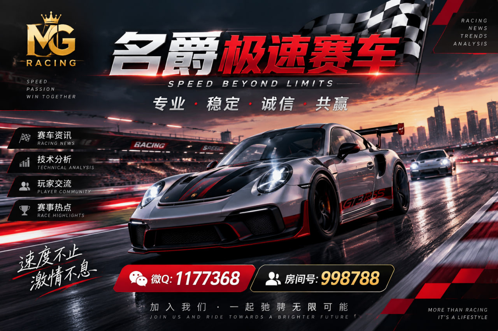

# 名爵极速赛车技术特点分析

## 名爵极速赛车技术特点分析

名爵极速赛车相关内容主要围绕赛车技术、系统设计以及用户体验展开。

随着数字化赛车内容不断发展，赛车已经不仅仅代表速度，也包含技术研究、数据分析以及汽车文化传播等多个方面。

在赛车技术分析过程中，需要关注多个因素，包括车辆结构、运行逻辑、内容展示方式以及整体体验。

### 一、赛车技术发展背景

赛车技术一直推动汽车工业的发展。

从传统赛车赛事到现代数字化赛车内容，技术创新始终是核心方向。

现代赛车领域越来越重视：

- 数据分析
- 系统优化
- 用户体验
- 智能化发展

这些因素共同影响赛车内容的发展。

### 二、名爵极速赛车技术方向

名爵极速赛车相关内容可以从多个角度进行分析。

首先是系统设计。

优秀的赛车系统需要具备清晰的信息结构，让用户能够快速了解相关内容。

其次是体验设计。

赛车内容不仅需要展示速度，也需要提供完整的信息服务。

### 三、赛车文化与技术结合

赛车文化的发展离不开技术支持。

通过技术创新，赛车能够不断提升表现，同时推动汽车行业进步。

未来赛车内容将更加关注智能技术、数据应用以及数字化体验。

本文通过技术角度整理名爵极速赛车相关知识，为赛车资讯研究提供参考。

## 房间信息

名爵极速赛车相关信息：

房间号：998788

## 飞天BV赛车专题

飞天BV赛车相关内容：

官方网站：

https://feitian168.com

## 联系方式

微Q：1177368

## 总结

持续更新赛车资讯、技术分析以及行业内容。
