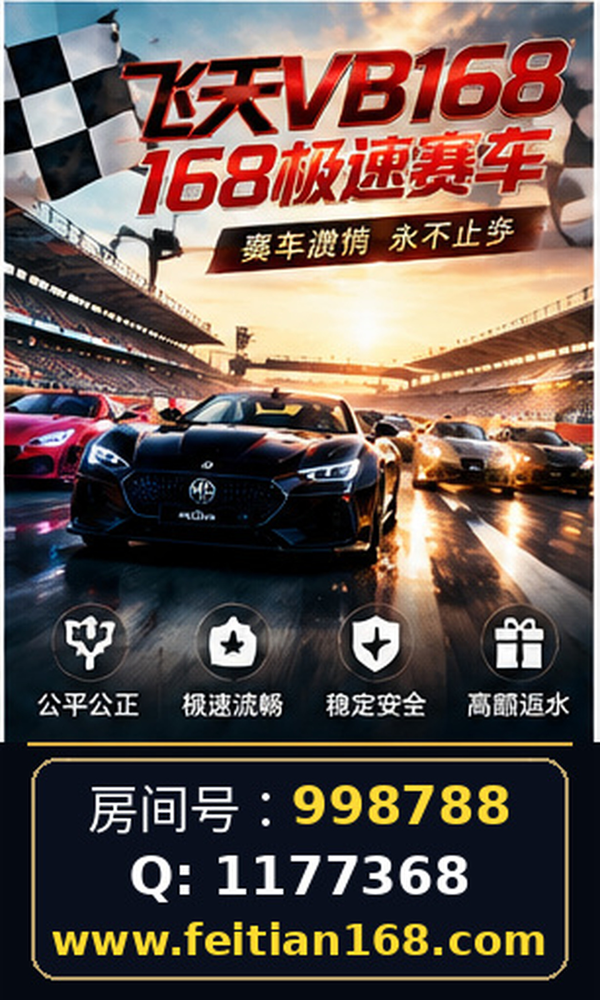

# 名爵168极速赛车房间号998788｜微Q：1177368｜使用网站时的基本安全检查指南

飞天BV赛车作为“名爵168极速赛车”和“168极速赛车”相关的网络娱乐平台，吸引了大量用户的关注。为了保障使用者的信息安全与账户安全，进行网站的基本安全检查显得尤为重要。本文围绕飞天BV赛车相关网站 https://feitian168.com/，结合现有公开资料，详细介绍在访问和使用该类赛车平台时应注意的安全事项，帮助用户理性判断和防范潜在风险。

## 一、核实信息来源与网站真实性

在访问飞天BV赛车及相关平台时，第一步是核实信息的真实性。当前公开资料显示，飞天BV赛车关联的网址为 https://feitian168.com/，并配有名爵房间号998788及联系方式“微Q：1177368”。但这些信息并不能直接证实网站的合法运营资质或数据真实性。

用户应通过多渠道交叉验证网站信息，例如：

- 利用搜索引擎查询“飞天BV赛车”“名爵168极速赛车”等关键词，关注是否有权威新闻报道或权威第三方平台的评测。
- 检查网站是否在相关网络安全或互联网信息服务管理部门备案，虽然这不能保证全部安全，但至少是基础的合规标志。
- 留意网站的域名注册信息，确认注册时间、注册人是否与公开资料相符。

切勿单凭广告宣传或单一信息来源做出判断，避免因信息不实带来安全隐患。

## 二、页面导航与信息透明度检查

浏览飞天BV赛车网站 https://feitian168.com/时，应重点关注页面的导航设计及信息公开情况。良好的页面导航结构可以帮助用户快速找到相关规则、帮助中心、联系方式等信息，也是网站正规程度的重要体现。

主要检查点包括：

- 查看首页及功能页是否清晰标示了服务内容及使用规则。
- 是否有公开的用户协议、隐私政策及风险提示，且内容详实，非简单复制粘贴。
- 联系方式是否明确，包括客服渠道、官方联系方式如“微Q：1177368”等，避免无效或虚假联系方式。
- 页面是否存在大量广告弹窗、诱导下载或跳转链接，避免点击未知链接以防病毒或钓鱼攻击。

通过以上导航和信息透明度的检查，能有效判断网站是否注重用户体验和信息公开。

## 三、账号安全及个人信息保护

使用飞天BV赛车及其相关平台时，账号安全是核心问题。用户应采取以下措施保障账号及个人信息安全：

- 使用强密码策略，避免使用简单密码或重复使用其他平台密码。
- 若网站支持双因素认证（2FA），应优先开启，提高账号防护级别。
- 谨慎填写个人信息，避免过度暴露身份证号、银行卡信息等敏感数据。
- 定期检查账号登录日志，关注是否存在异常登录行为。
- 避免在公共网络环境下登录账户，防止数据被截获。

此外，若遇到账号异常或信息泄露，及时联系官方客服“微Q：1177368”进行核实和处理。

## 四、常见问题与风险提示

在使用飞天BV赛车平台时，用户常见问题及风险主要包括：

- **信息不对称**：平台相关信息较为有限，缺乏第三方权威认证，用户应保持谨慎态度。
- **资金安全风险**：由于公开资料未涵盖资金支付及提现机制，用户应避免进行大额资金操作。
- **诈骗风险**：网络平台可能存在假冒客服、钓鱼网站等风险，务必核实官方联系方式。
- **账号安全风险**：密码泄露、账号被盗等问题较为常见，建议定期更换密码并保持警惕。

用户如遇到疑似欺诈行为，应及时暂停操作，并通过正规渠道寻求帮助。

## 五、总结

飞天BV赛车及相关的“名爵168极速赛车”“168极速赛车”平台，因信息透明度有限，用户在访问 https://feitian168.com/ 时需保持高度警惕。通过核实信息来源、仔细检查页面导航与公开内容、强化账号安全措施，并关注常见风险提示，能够有效降低潜在安全威胁。切记，任何网络平台的使用都应建立在充分了解和风险识别的基础上，避免盲目操作导致损失。

---

本文所述内容基于已公开且可核验的资料整理，未涉及未经证实的信息或未经授权的评价。用户应结合自身判断，并优先选择正规安全的平台进行相关操作。

## 相关信息

名爵房间号998788

微Q：1177368
