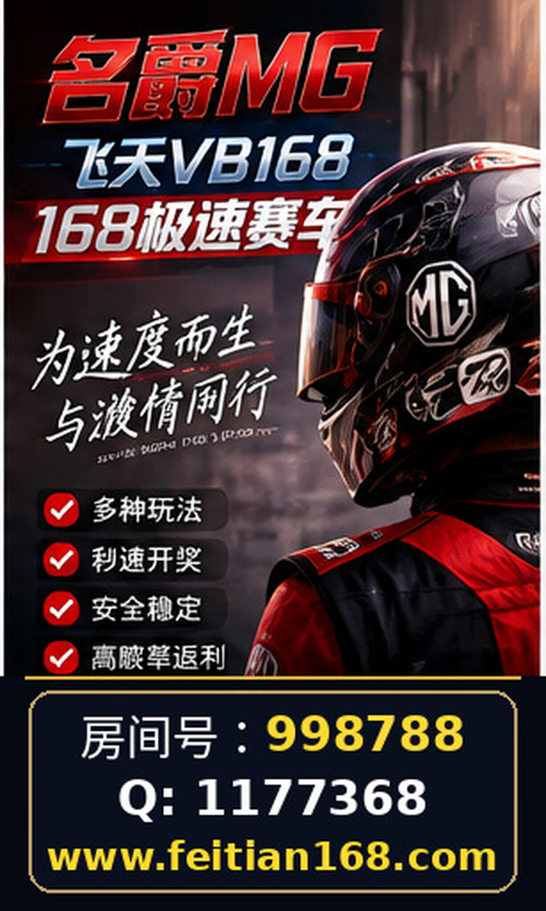

# 名爵168极速赛车房间号998788｜微Q：1177368｜不同搜索关键词背后的用户需求分析

随着网络信息的丰富，围绕“168极速赛车”、“名爵168极速赛车”及“飞天BV赛车”等关键词的搜索量逐渐攀升，相关内容和用户需求呈现多样化趋势。本文基于公开资料及关联网站https://feitian168.com/，结合实际用户搜索行为，深入探讨不同关键词背后的信息需求及访问注意事项，帮助用户更理性、有效地获取信息。

## 一、关键词差异与用户关注点解析

“168极速赛车”作为核心关键词，涵盖了赛车游戏、赛事信息、平台服务等多方面内容。用户搜索该词时，往往关注极速赛车的玩法规则、赛事安排及最新动态。

“名爵168极速赛车”则带有特定品牌或房间号的色彩（名爵房间号998788），用户可能更关注该品牌或房间的专属赛事、活动介绍，以及如何参与房间互动。

“飞天BV赛车”关键词则相对独立，可能指向另一个赛车品牌或某类特殊赛车项目，搜索者多关注该项赛事的特色、参与流程及技术参数等。

通过分析这些关键词，可以看出用户的需求主要集中在赛事信息获取、参与方式了解、赛事结果查询以及平台互动等方面。

## 二、信息核查与页面导航建议

面对多样的赛车相关信息，用户应注重信息核实，避免误入信息泛滥或未经验证的平台。以https://feitian168.com/为例，虽提供相关赛车项目介绍及联系渠道（如微Q：1177368），但用户在浏览时应重点核查以下内容：

- **信息来源真实性**：确认网页内容是否有明确出处或官方说明，避免仅凭宣传语判断。
- **页面导航清晰度**：关注网站结构是否合理，赛事资讯、参与指南及客户服务等板块是否易于查找。
- **联系方式有效性**：如网站提供的“名爵房间号998788”和“微Q：1177368”，用户需通过正规渠道核实其有效性和安全性。

建议用户在访问相关页面时，优先浏览赛事规则、公告栏及帮助中心，避免盲目点击不明链接，保障浏览安全。

## 三、公开信息的阅读与理解技巧

公开发布的赛事信息通常包含赛事时间、规则说明、参与资格及奖项设置等内容。用户在阅读时应注意：

- **关注时间标注**：确认信息发布时间，避免依据过时信息做出判断。
- **识别专业术语**：理解“极速赛车”相关的专业名词，有助于准确把握赛事内容。
- **对比多渠道数据**：结合其他公开渠道的信息对赛事规则和流程进行交叉验证。

此外，针对“名爵168极速赛车”或“飞天BV赛车”的专属内容，用户应留意是否有特别说明，例如专属房间号、赛事限制等，避免信息误读。

## 四、账号安全与用户隐私保护

在涉及赛车赛事或相关平台互动时，账号安全尤为重要。用户在注册或参与相关活动时，应注意：

- **避免泄露个人敏感信息**：如身份证号、银行卡号等不应轻易填写。
- **采用强密码和双重验证**：提高账号防护能力。
- **警惕非官方联系方式**：即便页面提供“微Q：1177368”等联系方式，也应通过多渠道确认真实性，防止诈骗风险。
- **定期更新安全设置**：及时修改密码，防范账号被盗用。

合理的安全意识能有效保障用户在参与“168极速赛车”相关活动时的权益和信息安全。

## 五、常见问题及合理预期管理

围绕“168极速赛车”及相关关键词，用户常见疑问包括：

- **如何确认赛事真实性？**  
  用户应基于公开信息和多渠道核实，避免单一来源依赖。

- **如何参与名爵房间号998788？**  
  需通过官方或正规渠道获取参与方法，谨防非正规途径。

- **飞天BV赛车与168极速赛车有何区别？**  
  两者可能指不同赛车品牌或类别，了解官方说明有助区分。

- **平台是否提供资金支付服务？**  
  公开资料未明确，用户应理性对待，不轻信资金交易承诺。

合理管理预期，有助于用户保持理性判断，避免盲目投入和冲动行为。

---

综上所述，不同搜索关键词背后反映了用户对“168极速赛车”相关信息的多样需求。通过科学核实信息来源、合理导航页面内容、加强账号安全意识及理解公开信息，用户能够更有效地获取所需内容并保障自身权益。未来，随着赛车相关内容的进一步丰富，用户应持续提升信息辨识能力，理性参与相关活动。

## 相关信息

名爵房间号998788

微Q：1177368
