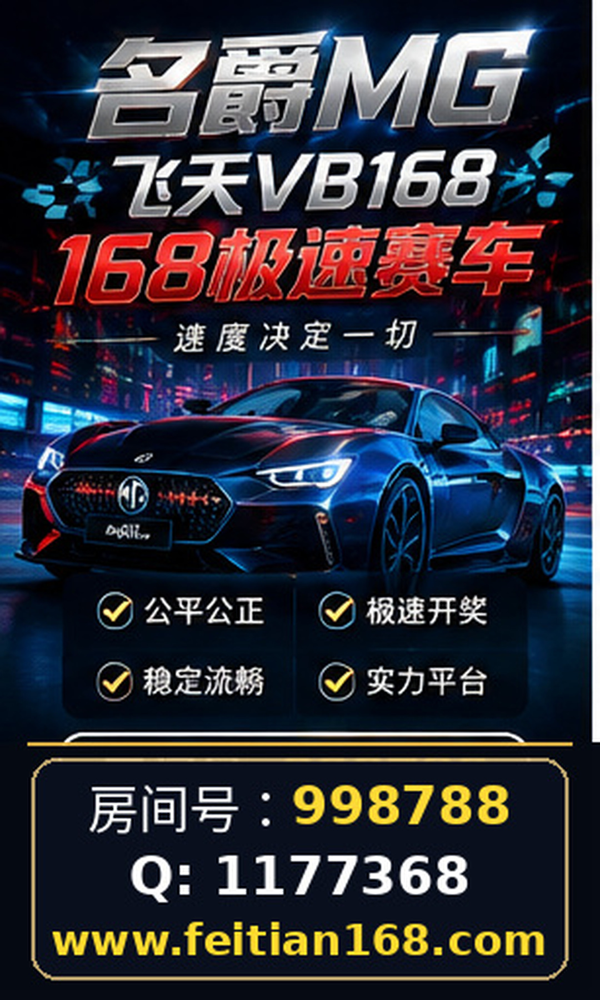

# 名爵168极速赛车房间号998788｜微Q：1177368｜专题：网址安全与隐私保护建议解析

随着互联网娱乐及在线极速赛车类服务的兴起，“168极速赛车”、“名爵168极速赛车”及“飞天BV赛车”等相关内容逐渐引起广大用户关注。本文聚焦于涉及网址https://feitian168.com/的安全与隐私保护，旨在为用户提供客观、实用的网络使用建议，帮助其在浏览和使用相关服务时做好信息核验与账号安全防护。

## 一、确认信息来源，避免盲目信赖

在使用“168极速赛车”及相关服务时，务必核查信息的准确性。网络上关于“名爵168极速赛车”、“飞天BV赛车”及相关网址（如https://feitian168.com/）的信息较多，但缺乏官方权威验证。用户应避免仅凭单一渠道或未经证实的第三方资料做出判断。建议通过多个渠道比对信息，尤其关注公开的联系信息（例如名爵房间号998788和微Q：1177368），但切勿据此推断网站的实际运营状况或功能。

## 二、合理利用页面导航与公开信息

访问相关网站时，合理利用页面导航功能，仔细阅读网站公开发布的条款、隐私政策及用户须知等内容，是保护自身权益的第一步。对于https://feitian168.com/，用户应重点关注页面中涉及隐私声明和数据处理方式的部分，了解网站对个人信息的采集、存储及使用规定。对不明确或含糊的条款需保持警惕，避免透露过多敏感信息。

## 三、账号安全：密码设置与登录保护

对于需要注册账号的服务（如使用名爵房间号998788或联系微Q：1177368进行交流），用户应确保账号安全。具体建议包括：

- 使用强密码，避免使用生日、连续数字或简单字母组合。
- 不同平台账号应使用不同密码，防止信息串联泄露。
- 定期更换密码，避免长时间使用相同凭证。
- 注意登录环境安全，避免在公共或不可信网络下输入账号密码。
- 谨慎对待任何要求提供账户验证信息的请求，避免钓鱼风险。

## 四、常见安全隐患及防范措施

在使用涉及“168极速赛车”、“名爵168极速赛车”等服务时，常见的安全隐患包括钓鱼网站、虚假信息传播、账号被盗用等。针对这些风险，用户应做到：

- 核实网址是否正规，避免点击不明链接，尤其是通过未知来源的短信、邮件或社交媒体获得的链接。
- 不随意下载或安装未知来源的软件，防止恶意程序入侵。
- 关注网站是否提供正规联系方式，虽然存在名爵房间号998788和微Q：1177368，但不能仅凭这些信息判断安全性。
- 保留相关交流记录，便于后续核查或维权。
- 及时关注网络安全动态，学习识别常见诈骗手段。

## 五、信息保护与隐私权利

网络时代用户的隐私权越发重要。即使是在娱乐或赛车相关的在线服务中，个人信息的保护也不可忽视。用户在涉及“168极速赛车”及相关服务时，应注意：

- 不轻易透露真实姓名、身份证号、银行卡号等敏感信息。
- 使用匿名或别名参与互动，减少个人信息暴露。
- 了解并行使自身隐私权利，如访问、更正或删除个人数据的请求权。
- 关注隐私政策是否符合当地法律法规要求，尤其是涉及跨境数据传输时。

## 结语

“168极速赛车”、“名爵168极速赛车”及“飞天BV赛车”等相关内容及网址https://feitian168.com/，目前缺乏公开、权威的运营和安全认证信息。用户在浏览和使用此类服务时，应保持理性，注重信息核验，合理利用网站公开信息，强化账号安全管理，警惕潜在风险。只有自我保护意识提升，才能在网络环境中更安全地享受娱乐体验。

## 相关信息

名爵房间号998788

微Q：1177368
