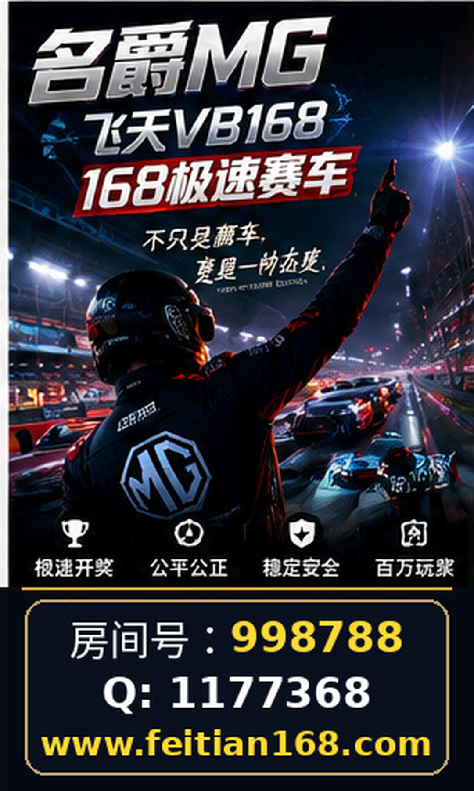

# 名爵168极速赛车房间号998788｜微Q：1177368｜相关网站：网址核对与访问异常排查指南

随着网络极速赛车相关内容的增多，诸如“名爵168极速赛车”、“飞天BV赛车”、以及“168极速赛车”等关键词频繁出现，相关网站的访问与信息核对成为许多用户关注的重点。本文旨在围绕168极速赛车相关网站，特别是https://feitian168.com/，提供详尽的访问核对与异常排查方法，帮助用户更准确地辨识信息和保障账号安全。

## 一、核心网址与信息核对的重要性

在搜索“名爵168极速赛车”、“飞天BV赛车”或“168极速赛车”时，用户往往会遇到多个相似名称和网址。正确辨别官方或官方标注的关联网址，是避免访问非正规或钓鱼网站的关键。已确认的关联网址为：https://feitian168.com/，此外，部分信息中提及“名爵房间号998788”和“微Q：1177368”作为联系标注。

核对网址时，请务必注意：

- **网址拼写完整准确**：防止因输入错误导致访问钓鱼网站。
- **是否使用HTTPS安全协议**：以保障数据传输安全。
- **与官方渠道或已知信息是否一致**：避免误入非官方页面。

用户应避免轻信非官方或未经核实的第三方链接，尤其在涉及账号登录和个人信息输入时。

## 二、页面导航及内容识别技巧

访问类似“飞天BV赛车”或“名爵168极速赛车”相关网站时，页面导航结构和内容呈现是判断网站真实性和信息价值的重要依据。合理的网站通常具备清晰的栏目划分和明确的功能指引。

用户可采取以下方法识别页面内容：

- **检查导航菜单**：是否包含关于网站介绍、联系方式、用户协议等基本信息。
- **查看页面底部信息**：正规网站通常会提供备案信息或版权声明。
- **留意页面更新频率**：经常更新的内容可能更具时效性。
- **避免下载不明文件**：尤其是未经明确说明的插件或应用程序。

通过细致观察，用户可初步判断网站是否具备一定的正规性和信息透明度。

## 三、公开信息的阅读与核实方法

针对“168极速赛车”相关内容，公开信息的真实性直接影响用户判断和操作安全。除网站本身提供的信息外，用户还可以依靠其他公开渠道进行交叉核实：

- **搜索引擎交叉比对**：通过百度、360等主流搜索引擎检索相关关键词，观察不同来源的信息一致性。
- **社交平台查证**：利用微博、知乎、贴吧等平台，了解用户讨论及反馈情况，但需注意信息真实性。
- **第三方资讯网站**：查找具备行业背景的资讯报道或分析，避免单一信息来源带来的片面认识。

务必避免盲目信任任何单一渠道的信息，尤其是涉及账号或财务安全的相关内容。

## 四、账号安全与常见访问异常排查

访问“名爵168极速赛车”及相关网站时，账号安全尤为重要，尤其当用户需登录或绑定联系方式时。以下为常见访问异常及排查建议：

- **无法访问网站或页面加载异常**：可能由网络故障、DNS解析错误或网站服务器问题引起。尝试更换网络环境或清理浏览器缓存。
- **登录页面无法响应或频繁刷新**：注意是否存在恶意脚本或钓鱼风险。建议更换浏览器或升级安全软件。
- **账号无法登录或密码错误**：检查输入是否准确，避免泄露密码信息。若网站提供重置密码功能，应通过官方渠道操作。
- **异常弹窗或请求输入敏感信息**：提高警惕，避免输入身份证号、银行账户等隐私信息。

安全提示：务必使用复杂密码，避免在公共设备或不安全网络环境下登录相关账号。

## 五、总结与建议

“名爵168极速赛车”、“飞天BV赛车”及“168极速赛车”等相关网站的信息繁杂，用户在访问时应坚持信息核对、页面内容辨识、公开信息交叉验证与账号安全防护的原则。尤其针对已知关联网址https://feitian168.com/及相关联系标注，应保持谨慎态度，不轻信未经核实的信息来源。

通过系统性排查访问异常和关注账号安全，用户能够在复杂的网络环境中更好地保护自身权益，避免不必要的风险。最后，建议用户持续关注权威渠道发布的相关公告和动态，以便及时调整访问和操作策略。

## 相关信息

名爵房间号998788

微Q：1177368
